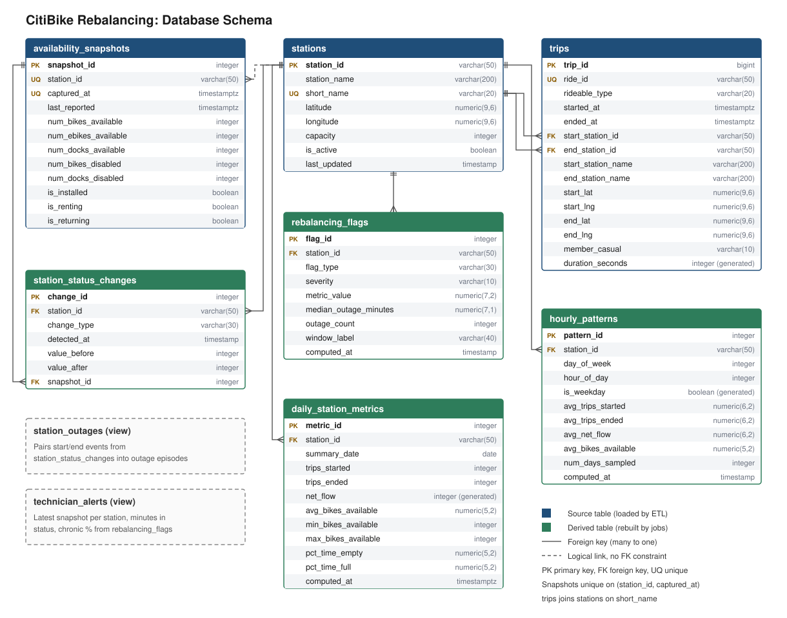

# CitiBike Station Rebalancing Analysis

A data engineering project that tells a CitiBike operations team which stations need bikes or docks **right now**, how long they have been in trouble, and which stations fail **over and over** during weekday rush hour.

**Stack:** PostgreSQL · Python · Flask · cron · AWS Lightsail


---

## The Problem

CitiBike moves bikes between stations by truck. That work is usually reactive: a station is found empty after riders have already been stranded. A dispatcher needs answers to three different questions, and each one needs different data:

| Question | Answered by | How fresh |
|---|---|---|
| Is this station in trouble **now**? | `technician_alerts` view (latest snapshot) | every 5 minutes |
| How **long** has it been empty or full? | `station_outages` view (paired status changes) | every 5 minutes |
| Is this a **recurring** rush-hour problem? | `rebalancing_flags` table | weekly |

The dashboard combines them. A station that is empty right now **and** is chronically empty at rush hour goes to the top of the list.

---

## What It Produces

**At risk list (live):** stations that are empty, full, or close to it in the latest snapshot. "Near" means 10% of stations' capacity. Each row shows how many minutes the station has been in that state and its chronic rush hour percentage.

**Rebalancing flags (weekly):** one row per station, per flag type, per rush window (weekdays 07:00–09:59 and 17:00–19:59, New York time).

| Flag | Meaning | Metric | Severity (low / medium / high) |
|---|---|---|---|
| `chronic_empty` | Often has 0 bikes during rush hour | % of in-service rush snapshots with 0 bikes | ≥ 10% / 25% / 50% |
| `chronic_full` | Often has 0 open docks during rush hour | % of in-service rush snapshots with 0 docks | ≥ 10% / 25% / 50% |
| `imbalance_toward_empty` | Riders drain it over the window | average net bikes lost over the window, as % of capacity | ≥ 50% / 75% / 100% |
| `imbalance_toward_full` | Riders fill it over the window | average net bikes gained over the window, as % of capacity | ≥ 50% / 75% / 100% |

Chronic flags also carry `median_outage_minutes` and `outage_count`. These separate a station that blips empty for 2 minutes from one that stays empty for an hour.

**Flask dashboard and REST API** with these panels: at risk stations now, system overview, top problem stations per flag type, flag summary, rush hour trouble stations ranked by outage length, and stations with the worst all day availability.

---

## Architecture

```
GBFS API (every 5 min)                   CitiBike S3 trip CSVs (monthly)
station_status / station_information             |
        |                                        |
        ▼                                        ▼
availability_snapshots, stations               trips ------------
        |                 |                      |              |
        |                 ▼ detect transitions   ▼              |
        |          station_status_changes   hourly_patterns     |
        |                 |                      |              |
        |           pair outage start ↔ end      |              |
        |                 ▼                      |              |
        |          station_outages (view)        |              |
        |                 |                      |              |
        |                 └──────────┬───────────┘              |
        |                            ▼                          ▼ 
        |                    rebalancing_flags     daily_station_metrics
        |                            |                      |
        ▼                            ▼                      |
technician_alerts (view) ◄──── chronic %                    |
        |                                                   |
        └───────────────────►  Flask API + Dashboard  ◄─────┘
```

---

## Data Model



**Source tables** (loaded by ETL)
- `stations`: one row per station (~2,400), from the GBFS station feed.
- `availability_snapshots`: one row per station every 5 minutes (~9.6M rows). Unique on `(station_id, captured_at)`, so a snapshot can never be loaded twice.
- `trips`: one row per trip from the CitiBike S3 archive (~3.3M rows). Unique on `ride_id`. Linked to `stations` through `short_name`, because the trip CSVs and the live feed use different station ID formats.

**Derived tables** (disposable: rebuilt from the source tables)
- `station_status_changes`: one row per state change (became empty, recovered, went offline, …). Compresses millions of snapshots into a small event log, and makes duration measurable.
- `daily_station_metrics`: one row per station per day: trips started and ended, average/min/max bikes, % of in-service time empty and full.
- `hourly_patterns`: one row per station per day per hour: average trips started, ended, and net flow.
- `rebalancing_flags`: one row per station per flag type per rush window.

**Views** (computed when queried, never stale)
- `station_outages`: one row per outage episode with start, end, minutes, whether it is still ongoing, and whether it overlapped an offline period.
- `technician_alerts`: the latest snapshot per station, classified as empty / full / near_empty / near_full, with minutes in that state and chronic rush-hour percentage.

---

## Pipeline and Schedule

Each job runs on the cadence of the data that actually changes its result.

| Job | Runs | Refresh style | Why this cadence |
|---|---|---|---|
| Collect snapshots, detect status changes | every 5 min | append only | the live feed has no history; missed snapshots are lost |
| `daily_station_metrics` | nightly | recompute the last 2 days | late snapshots can change yesterday |
| `rebalancing_flags` | weekly | full rebuild in one transaction | recurring patterns change slowly |
| `hourly_patterns` + trip columns of `daily_station_metrics` | after each monthly trips load | full rebuild / backfill that month | they only change when `trips` changes |
| `station_outages`, `technician_alerts` | on read | views | always current |

Every job is safe to rerun: loaders use `ON CONFLICT`, rebuilds use `TRUNCATE` or `DELETE` inside a transaction, and `flock` stops two copies of a job from running at once. The schedule lives in [`deploy/crontab`](deploy/crontab).

**Why cron and not Airflow.** There are four scheduled jobs and the only dependency (rebuild `hourly_patterns` after loading trips) is chained inside one script. Airflow would add a scheduler, a metadata database, and a web server for no gain. It becomes the right tool once jobs depend on each other, need date range backfills, or need visible retries.

---

## Time Zones

- `captured_at`, `started_at`, and `ended_at` are stored as `TIMESTAMPTZ`.
- GBFS snapshots arrive in UTC. Trip CSVs are New York local time and are tagged `America/New_York` when loaded.
- Every job starts with `SET LOCAL TIME ZONE 'America/New_York'`, so rush-hour and day-of-week logic uses New York time regardless of the server's setting. The database default is also set to New York.

---

## Data Quality

- **Duplicate trips found and fixed.** 250,000 rides had been loaded three times by an early version of the loader, inflating trip counts by about 15%. The extra 500,000 rows were removed, a `UNIQUE (ride_id)` constraint was added so the loader's `ON CONFLICT` actually protects against reloads, and every table built from trips was rebuilt.
- **Out-of-service snapshots are excluded.** A station switched off for maintenance reports 0 bikes. Empty rates only count snapshots where the station is installed and renting; full rates only where it is installed and accepting returns.
- **Unpublished trips are NULL, not 0.** Trip data arrives monthly, so recent days have no trip counts yet. They are stored as NULL ("not published") so the dashboard does not show a false zero.

---

## Key Technical Decisions

**Three layers: now, duration, reputation.** A percentage like "empty in 40% of rush snapshots" cannot tell 42vminute blips from one 3 hour outage. The event log and outage view make duration measurable, and the live view answers "right now." Each layer answers a different question.

**AM and PM are separate windows.** A station near offices fills in the morning and drains in the evening. Averaged together it looks balanced; split, it gets two flags with opposite actions.

**Outages are matched to rush hour by overlap, not by start time.** A station that was already empty when the rush began is often the worst one. Matching on `started_at < window_end AND ended_at > window_start` counts it.

**Median, not mean, outage minutes.** Durations are right-skewed, so a few very long outages would dominate a mean.

**Ongoing outages are excluded from duration.** An outage still in progress has an unknown end, so including it would bias medians low. Outages that overlap an offline period are excluded too, since a truck can't fix those.

**Thresholds in one place.** All flag thresholds and sample size guards live in a single `params` CTE, so they can be tuned and explained in one spot.

**Views compute on read, tables on a schedule.** Outage episodes and live alerts are views, so they always match the event log. Flags are a table: a weekly verdict that stays fixed until the next run.

---

## Limitations

<!-- Check these numbers against the dashboard's date range before publishing. -->
- **Short history.** Snapshots cover about two weeks of January 2026. Imbalance flags rest on only a few days per weekday; more months would make them more stable.
- **Different periods.** Chronic flags use snapshots, while imbalance flags use the trip window, so the two describe slightly different periods.
- **Collection gaps.** If the collector stops, the first snapshots after the restart can create false outages lasting months. The flags avoid this by using a closed date window, and the live view ignores events from before the restart. The proper fix is to exclude any outage that spans a gap in collection.
- **No freshness alert yet.** The first addition for production would be an alert when the newest snapshot is more than 15 minutes old. That is how the collection gap above would have been caught early.

---

## Running It

**Prerequisites:** PostgreSQL 16, Python 3.9+

```bash
git clone https://github.com/rime11/citibike-rebalancing-api
cd citibike-rebalancing-api
pip install -r requirements.txt
cp .env.example .env                       # fill in your PostgreSQL credentials

psql -d citibike -f schema/schema.sql      # empty tables, views, indexes

# Source data (stations first; the other tables reference it)
python3 scripts/backfill/load_station_info.py
python3 scripts/backfill/fetch_snapshots.py && python3 scripts/backfill/load_snapshots_data.py
python3 scripts/backfill/trips/load_trips.sh 202601-citibike-tripdata.csv

# One-time build of every derived table, in dependency order
jobs/build_all.sh

# Dashboard (http://localhost:5000); FLASK_DEBUG=1 for local debugging only
cd citibike_api && python app.py

# Production schedule
crontab deploy/crontab
```

---

## Project Structure

```
citibike-rebalancing-api/
├── citibike_api/
│   ├── app.py               # Flask routes
│   ├── db.py                # Database connection
│   ├── queries.py           # Dashboard and API queries
│   └── templates/           # Dashboard HTML
├── scripts/data_collection/ # ETL: fetch and load snapshots, stations, trips
├── schema/
│   └── schema.sql           # Full schema, generated with pg_dump -s
├── sql_scripts/
│   ├── backfill/            # One-time builds
│   ├── refresh/             # Scheduled SQL refreshes
├── jobs/                    # build_all.sh, collect.sh, run_sql.sh, load_trips.sh
├── deploy/crontab           # Production schedule
├── notebooks/               # Exploration
├── .env.example
└── requirements.txt
```

---

## Data Sources

- Real-time availability: CitiBike GBFS feed, `https://gbfs.lyft.com/gbfs/2.3/bkn/en/station_status.json`
- Historical trips: CitiBike S3, `https://s3.amazonaws.com/tripdata/index.html` (not included in the repo because of size)

---

*Started as the DTSC 691 Database Capstone, Eastern University; reworked as a portfolio project.*


